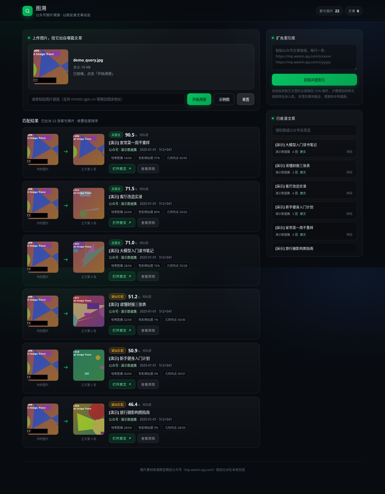

# 图溯 · 公众号图片溯源

> 上传一张图，在本地微信公众号图片指纹库中找出它出自哪篇文章。素材来源 100% 限定微信公众号（mp.weixin.qq.com）。



## 是什么、不是什么

| ✅ 能做 | ❌ 不做 |
| --- | --- |
| 在自己收录过的公众号文章图库内反查图片出处 | 联网全网反向图片搜索 |
| 抗缩放、压缩、轻度裁剪、加文字水印 | 抗大角度旋转 / 镜像翻转 / 蒙版遮挡 |
| 浏览器拖拽、粘贴截图、贴图片 URL 三种检索入口 | 跨终端账号体系、保存搜索历史 |
| 批量灌入文章，库越大命中率越高 | 主动抓取订阅号（需要登录态） |

## 工作原理

```
┌────────────┐    ┌──────────────┐    ┌──────────────┐
│ 你的图片    │ -> │ 三层特征提取  │ -> │ 内存向量检索  │ -> 命中文章
└────────────┘    │ dHash/pHash  │    │ 粗筛 + 精排  │
                  │ HSV 直方图   │    └──────────────┘
                  │ ORB 局部特征  │
                  └──────────────┘
```

**入库** 阶段对每张抓取到的微信 CDN 图片计算三组指纹并落库；**检索** 阶段先用 64 位感知哈希的汉明距离做毫秒级粗筛，候选集内再跑 HSV 颜色余弦 + ORB 特征匹配 + RANSAC 单应校验（几何内点数），三层加权得最终分。

之所以要 RANSAC：单看描述子匹配会撞上"花纹相近"的干扰图，强制通过平面几何一致性才能把那些巧合排除掉。

## 技术栈

- **后端** FastAPI + SQLAlchemy + SQLite + OpenCV（headless）+ Pillow + httpx
- **前端** Vite + React 18（JSX，零类型负担）
- **特征库** `backend/data/index.db`，图片本地缓存到 `backend/data/images/`

## 启动

### 方式 A · 单端口生产模式（推荐，部署即用）

前端构建成静态产物后由 FastAPI 同源托管，**只占一个端口**，直接对外可访问：

```bash
pip3 install -r backend/requirements.txt
cd frontend && pnpm install && pnpm build && cd ..
bash scripts/start.sh          # 监听 $PORT，默认 8000
# 打开 http://localhost:8000
```

> `start.sh` 会在指纹库为空时自动灌入演示数据，首次打开就有内容可搜。

### 方式 B · 开发模式（前后端分离，带热更新）

```bash
./scripts/restart.sh           # 后端 3000 + 前端 5173，已配 /api 代理
# 打开 http://localhost:5173
```

健康检查：
```bash
curl http://localhost:8000/api/health         # {"ok":true,"indexed":N}
curl http://localhost:8000/api/stats
```

## 用法速览

- **拖拽 / 点击 / `Ctrl+V` 粘贴** 上传一张图，点击「开始溯源」；或点「示例图」用内置示例一键体验。
- 想查"这张图从哪来"但库里没收录：在右侧粘贴若干 `https://mp.weixin.qq.com/s/...` 链接，系统会抓取正文图片自动建索引。
- 「图片 URL」输入框支持 `mmbiz.qpic.cn` 等微信图床地址（后端代下载，规避浏览器防盗链）。

## 脚本

| 脚本 | 作用 |
| --- | --- |
| `scripts/restart.sh` | 重启前后端 |
| `scripts/seed_demo.py` | 生成 6 篇演示文章 + 22 张程序生成图 + 1 张「传播版」查询图（沙箱/无外网时也能立刻看到检索效果） |
| `scripts/seed_collect.py` | 通过搜狗微信搜索抓真实文章链接（**需要能访问搜狗与微信**的环境，国内 IP 通常可用） |
| `scripts/import_urls.py` | 把链接文件批量灌进索引库并轮询进度 |

### 想用真实数据？

```bash
python3 scripts/seed_collect.py --per-keyword 5 --out scripts/seed_urls.txt
python3 scripts/import_urls.py scripts/seed_urls.txt
```

> 注意：搜狗对裸 HTTP 抓取有反爬，本脚本内置了浏览器渲染回退，需要沙箱能跑 Playwright / Chromium；如果你有更稳的公众号源（如自建 RSS、企业微信接口），直接把链接喂给 `scripts/import_urls.py` 即可。

## 接口

| Method | Path | 说明 |
| --- | --- | --- |
| `POST` | `/api/search` | 上传图片（form field `file`）或贴图床地址（`image_url`）检索 |
| `POST` | `/api/import` | `{urls:[...]}` 提交导入任务，返回 `job_id` |
| `GET`  | `/api/import/{job_id}` | 查询任务进度与逐条结果 |
| `GET`  | `/api/articles?q=` | 列出已收录文章（按标题/公众号筛选） |
| `DELETE` | `/api/articles/{id}` | 移除一篇（级联删除其图片） |
| `GET`  | `/api/preview/{image_id}` | 命中原图的本地缓存/回源预览 |
| `GET`  | `/api/proxy-image?url=` | 白名单代理（仅允许 `mmbiz.qpic.cn` 等微信域） |
| `GET`  | `/api/demo-query` | 内置传播版示例图 |
| `POST` | `/api/reindex` | 强制重载内存索引（导入完成后会自动调） |
| `GET`  | `/api/stats` | 库容量统计 |
| `GET`  | `/api/health` | 健康检查 |

## 调参与限制

- `backend/app/search.py`
  - `COARSE_TOP = 60`：进入精排的候选上限
  - `HASH_GATE = 22`：粗筛闸门（汉明距离超过此值仅保留前 10 个兜底）
- `backend/app/main.py`
  - `MIN_SCORE = 0.22`：低于此分视为未命中并从响应剔除
  - 颜色一致性惩罚：色彩相似度 `<0.35` 乘 `0.70`，`<0.60` 乘 `0.88` —— 防止"风格相近但完全不是同一张图"的误判
- 置信度：`high` 要求分数 ≥0.62 且 RANSAC 内点 ≥15

## 部署

应用是**单端口 HTTP 服务**（API + 静态页面同源），符合主流云平台的部署约定：监听环境变量 `PORT`，绑定 `0.0.0.0`。

### Docker（一行起）

```bash
docker compose up -d           # 构建并启动，访问 http://localhost:8000
docker compose logs -f web     # 看日志
```

镜像为多阶段构建：Node 22 编译前端 → Python 3.11-slim 运行时。指纹库与图片缓存通过 volume 挂载到 `./backend/data`，重建容器不丢数据。

### 云平台

| 平台 | 需要的文件 | 说明 |
| --- | --- | --- |
| Render | `render.yaml` | 已声明构建/启动命令与 1GB 持久盘，直接 Blueprint 导入 |
| Heroku / Dokku | `Procfile` | `web:` 启动命令 + `release:` 自动灌演示数据 |
| Fly.io / Railway / Koyeb | `Dockerfile` | 自动识别，只需设置 `PORT`（默认 8000） |
| 任意 VPS | `scripts/start.sh` | 配 systemd 或 supervisor 拉起即可 |

### 部署提示

- 反向代理时把 `/api/*` 与 `/assets/*` 都透传到后端；SPA 回退已由 `StaticFiles(html=True)` 处理。
- 持久化目录是 `backend/data/`（SQLite 库 + 图片缓存），**务必挂持久盘**，否则重启后索引清空。
- 想换数据库：把 `DATABASE_URL` 环境变量指向 MySQL/PostgreSQL 即可（SQLAlchemy 模型无需改）。
- OpenCV 用的是 `opencv-python-headless`，无需 X11/图形库；Dockerfile 里已装最小运行时依赖。
